# OpenGr8on dla VS Code — instrukcja

Rozszerzenie zastępuje Object Managera w codziennej pracy: projekt instalacji Grenton trzymasz jako
pliki tekstowe (YAML + Lua) w gicie, a rozszerzenie generuje z nich `OM.LUA` i `USER.LUA` dokładnie
takie, jakie wygenerowałby Object Manager, i wysyła je do CLU.

Rozszerzenie mówi po polsku, gdy VS Code ma polski pakiet językowy (*Configure Display Language* →
polski, pakiet „Polish Language Pack for Visual Studio Code”); inaczej po angielsku. Polecenia w
palecie (Ctrl+Shift+P) można wyszukiwać po obu nazwach, np. *Generuj OM.LUA* albo *Generate OM.LUA*.
Log techniczny (Output → OpenGr8on) jest po angielsku.

Zrzuty ekranu pochodzą z projektu demonstracyjnego [`docs/demo`](demo) (zmyślone nazwy i adresy).
Można go otworzyć i wypróbować wszystko poza komunikacją z CLU.

## Spis treści

1. [Wymagania i instalacja](#1-wymagania-i-instalacja)
2. [Nowy projekt](#2-nowy-projekt)
3. [Struktura projektu](#3-struktura-projektu)
4. [Widok projektu](#4-widok-projektu)
5. [Edycja YAML: obiekty, zdarzenia, akcje](#5-edycja-yaml-obiekty-zdarzenia-akcje)
6. [Skrypty Lua](#6-skrypty-lua)
7. [Błędy](#7-błędy)
8. [Generowanie, porównanie, wysyłanie](#8-generowanie-porównanie-wysyłanie)
9. [Urządzenia w sieci](#9-urządzenia-w-sieci)
10. [Ograniczenia](#10-ograniczenia)

## 1. Wymagania i instalacja

- VS Code 1.85 lub nowszy,
- rozszerzenie **Lua** (sumneko, `sumneko.lua`) — podpowiedzi i sprawdzanie skryptów,
- komputer w tej samej sieci co CLU (wykrywanie i wysyłanie działają przez UDP/TFTP w sieci lokalnej).

Instalacja z pliku `.vsix` (zbudowanego poleceniem `npm run package` albo pobranego z CI):

```bash
code --install-extension opengr8on-vscode.vsix
```

Rozszerzenie uruchamia się samo, gdy w otwartym folderze jest plik `opengr8on.yaml`, albo po użyciu
któregokolwiek polecenia OpenGr8on.

## 2. Nowy projekt

Są trzy drogi:

| Skąd | Jak |
|---|---|
| **Projekt Object Managera** (`.omp`) | Otwórz pusty folder → *OpenGr8on: Importuj z Object Managera (.omp)* → wskaż plik. Powstaną wszystkie CLU, moduły, obiekty, obiekty wirtualne, zdarzenia i skrypty; klucz projektu trafia do bezpiecznego magazynu VS Code (nigdy do plików). Pomijane są rzeczy usunięte w Object Managerze: CLU z kosza i usunięte obiekty wirtualne (lista w Output → OpenGr8on); skrypt, który wciąż odwołuje się do takiego CLU, pokaże błąd w tej linii. |
| **Działające CLU** | *OpenGr8on: Nowy projekt*, potem w widoku *Urządzenia (sieć)* na CLU: prawy przycisk → *Importuj do projektu…*. Konfiguracja jest czytana z `OM.LUA` na CLU; jeśli CLU jest puste — budowany jest szkielet z listy modułów (`CONFIG.JSON`). |
| **Od zera** | *OpenGr8on: Nowy projekt*, a pliki CLU piszesz sam (wzór: [`docs/demo`](demo), opis formatu: [PROJECT_FORMAT.md](PROJECT_FORMAT.md)). |

Przy pierwszym otwarciu projektu rozszerzenie konfiguruje wsparcie Lua i proponuje restart serwera
Lua — kliknij **Zrestartuj serwer Lua** (bez tego notacja `CLU->OBIEKT->...` będzie podkreślana do
czasu ponownego uruchomienia VS Code):

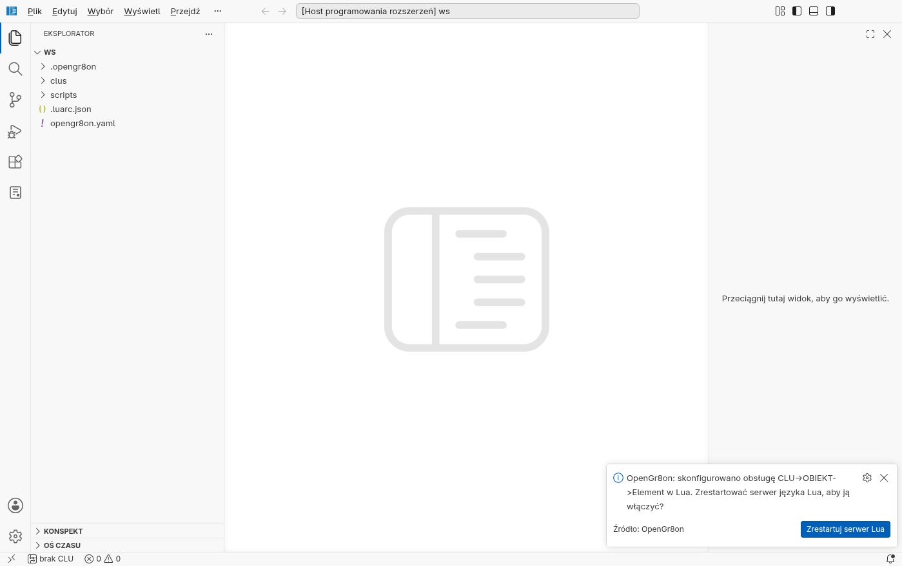

## 3. Struktura projektu

```
moj-dom/
  opengr8on.yaml              # nazwa projektu
  clus/
    PARTER.yaml               # jeden plik na CLU: CLU, moduły, obiekty, zdarzenia
    PIETRO.yaml
  scripts/
    PARTER/
      zamknij_rolety.lua      # skrypty danego CLU
  .opengr8on/                 # generowane (podpowiedzi Lua) — nie commitować
  build/                      # wygenerowane OM.LUA / USER.LUA — nie commitować
```

`.gitignore` z `build/` i `.opengr8on/` tworzy *Nowy projekt* / import.

## 4. Widok projektu

Ikona OpenGr8on na pasku bocznym otwiera dwa widoki: **Urządzenia (sieć)** — CLU wykryte w sieci —
i **Projekt**. W widoku projektu każde CLU ma:

- **Obiekty** — wejścia/wyjścia modułów pod przyjaznymi nazwami (jak w Object Managerze; obiekty bez
  własnej nazwy mają domyślną nazwę OM, np. `x330001001_PowerSupplyVoltage_01`). Numer modułu, kanał
  i identyfikator obiektu są w podpowiedzi po najechaniu myszą,
- **Obiekty wirtualne** — timery, termostaty, harmonogramy,
- **Skrypty** — skrypty CLU.

Kliknięcie elementu otwiera go w pliku YAML / skrypcie.

**Usuwanie:** prawy przycisk na obiekcie wirtualnym albo skrypcie → *Usuń…*. Najpierw sprawdzane
jest, czy coś go jeszcze używa (akcje zdarzeń, cechy-odwołania, skrypty — także zapis
`TIM1001:get(0)`). Jeśli tak, nic nie jest usuwane: okno pokazuje miejsca użycia, a *Pokaż użycia*
przenosi do każdego z nich. Nieużywany element znika z `clus/<CLU>.yaml`, a plik skryptu trafia do
kosza systemowego.

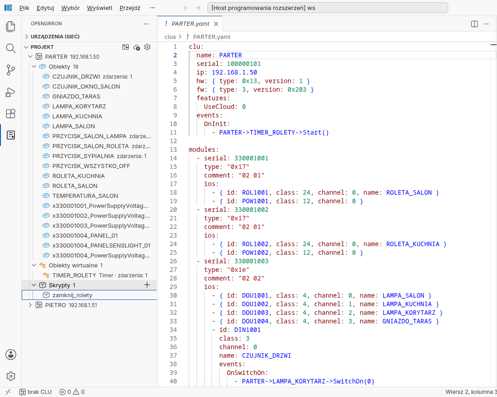

## 5. Edycja YAML: obiekty, zdarzenia, akcje

Każdy obiekt ma stały identyfikator (`id`, np. `ROL1001`) i przyjazną nazwę (`name`). W akcjach
zdarzeń używasz składni Object Managera z przyjaznymi nazwami:

```yaml
- id: BUT1001
  class: 7
  channel: 0
  name: PRZYCISK_SALON_LAMPA
  events:
    OnClick:
      - PARTER->LAMPA_SALON->Switch(0)          # obiekt na tym samym CLU
      - PIETRO->LAMPA_SYPIALNIA->Switch(0, 500) # obiekt na innym CLU
      - PARTER->zamknij_rolety()                # skrypt
```

Podpowiedzi (Ctrl+Spacja) działają na każdym poziomie: nazwa CLU → obiekt (najpierw przyjazne nazwy,
potem identyfikatory) → metoda z parametrami. W bloku `features:` podpowiadane są tylko cechy tego
obiektu, które można ustawić (bez już wpisanych), a w `events:` — jego zdarzenia.

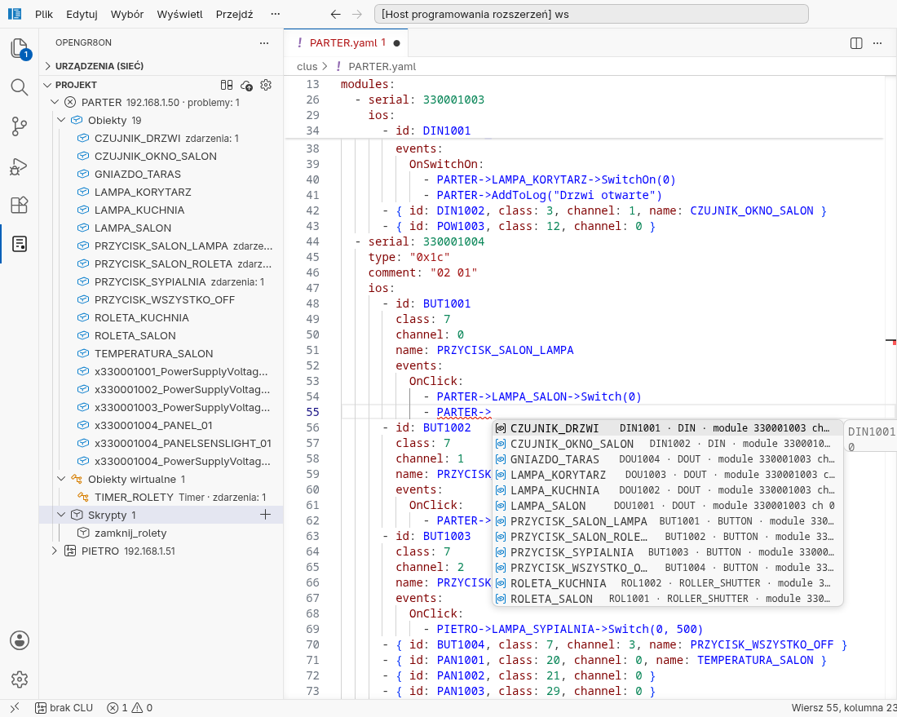

W bloku `features:` podpowiadane są wyłącznie cechy **tego konkretnego obiektu** (tu: CLU), które
można ustawić — z numerem, typem, jednostką i dozwolonymi wartościami; po wpisaniu `Nazwa: `
podpowiadane są dozwolone wartości. Cechy wyliczeniowe zapisuje się **nazwą**, nie liczbą:
`Mode: Bistable`, `TimeZone: Europe/Warsaw` (liczba też zadziała; import z OM zapisuje nazwy). W innych miejscach — tylko klucze dozwolone w danym miejscu
(`id`, `class`, `name`, …).

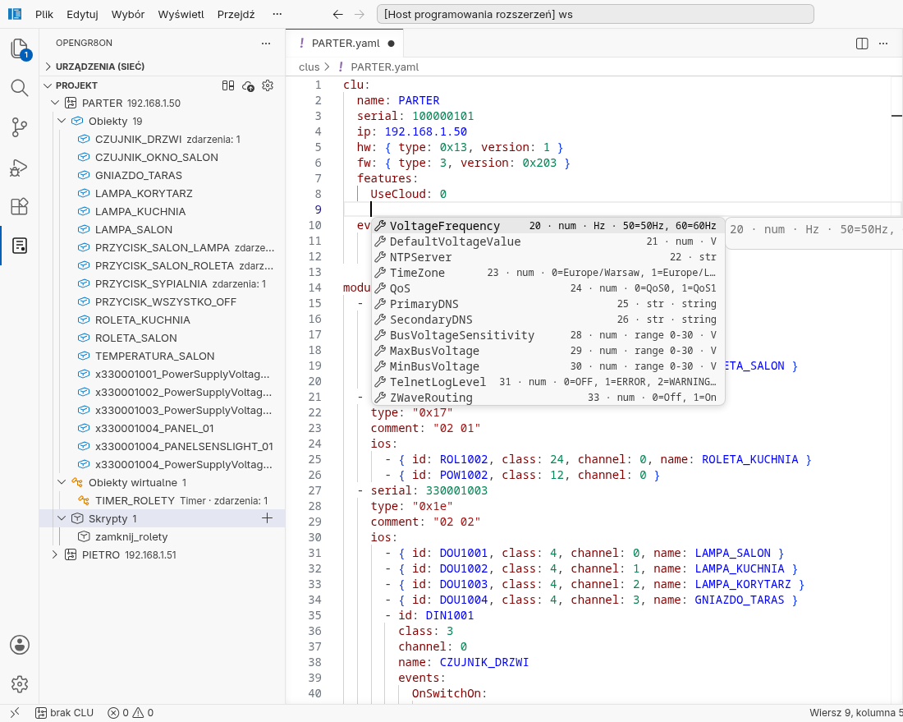

Obiekty wirtualne (timer, termostat, harmonogram) są w sekcji `objects:`:

```yaml
objects:
  - id: TIM1001
    class: Timer
    version: 1          # gdy obiekt ma kilka wersji interfejsu
    name: TIMER_ROLETY
    features: { Time: 600, Mode: CountDown }
    events:
      OnTimer:
        - PARTER->zamknij_rolety()
```

Akcje zdarzenia `OnInit` CLU (w `clu: events: OnInit:`) wykonują się przy starcie CLU.

## 6. Skrypty Lua

W skryptach do obiektów odwołujesz się jak w Object Managerze — **przyjaznymi nazwami**:

```lua
if PARTER->CZUJNIK_OKNO_SALON->Value == 0 then   -- odczyt cechy
  PARTER->ROLETA_SALON->MoveDown(0)               -- wywołanie metody
end
print(PIETRO->LAMPA_SYPIALNIA->Value)            -- obiekt na innym CLU
PARTER->PRZYCISK_SALON_LAMPA->Mode = Bistable     -- ustawienie cechy (nazwą lub liczbą)
PARTER->PRZYCISK_SALON_LAMPA->SetMode(Bistable)   -- to samo metodą
```

Rozszerzenie zamienia to na kod, który rozumie CLU (tak samo jak Object Manager). Działa też zapis
z kropkami (`PARTER.ROLETA_SALON.Stop()`) — to rozszerzenie OpenGr8on, Object Manager go nie zna.

Po wpisaniu `PARTER->` podpowiadane są obiekty tego CLU po przyjaznych nazwach:

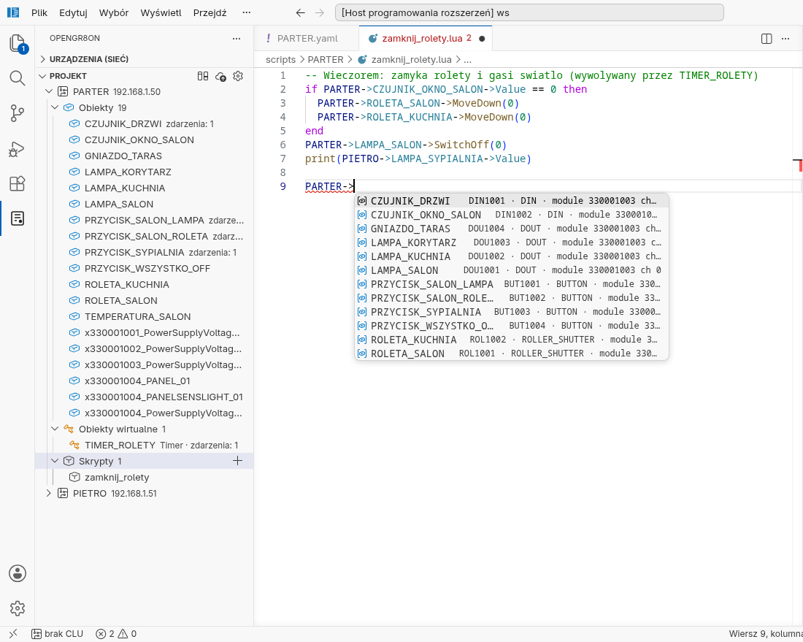

a po nazwie obiektu — jego cechy (z typem, zakresem i znaczeniem wartości) i metody:

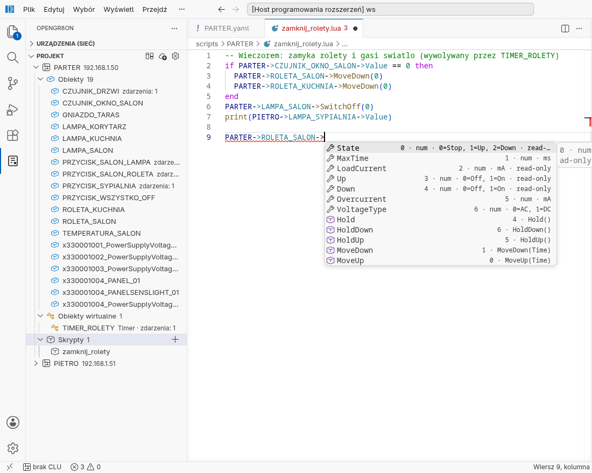

W zwykłym Lua (`DOU1001:get(0)`) przy identyfikatorach wyświetla się przyjazna nazwa obiektu, a przy
numerach — nazwa cechy lub metody:

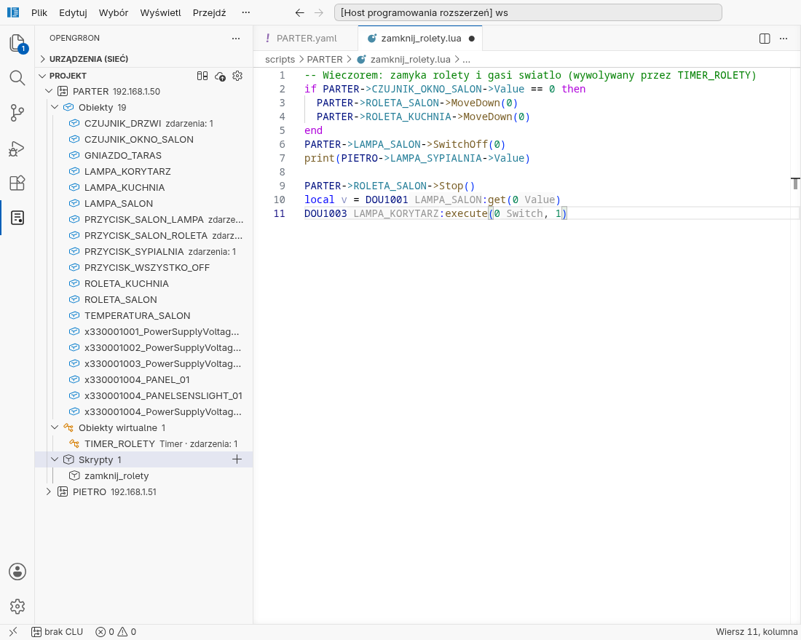

Zaznaczony fragment (albo bieżącą linię) można wykonać na CLU: **Ctrl+Alt+Enter** (*Wykonaj
zaznaczenie na CLU*); wynik pojawia się na pasku stanu i w panelu Output → OpenGr8on.

**Nowy skrypt:** w widoku projektu najedź na *Skrypty* danego CLU i kliknij **+** (albo prawy
przycisk na CLU → *Nowy skrypt…*), podaj nazwę. Powstaje plik `scripts/<CLU>/<nazwa>.lua`, wpis
w `clus/<CLU>.yaml` (bez naruszania reszty pliku) i plik otwiera się w edytorze.

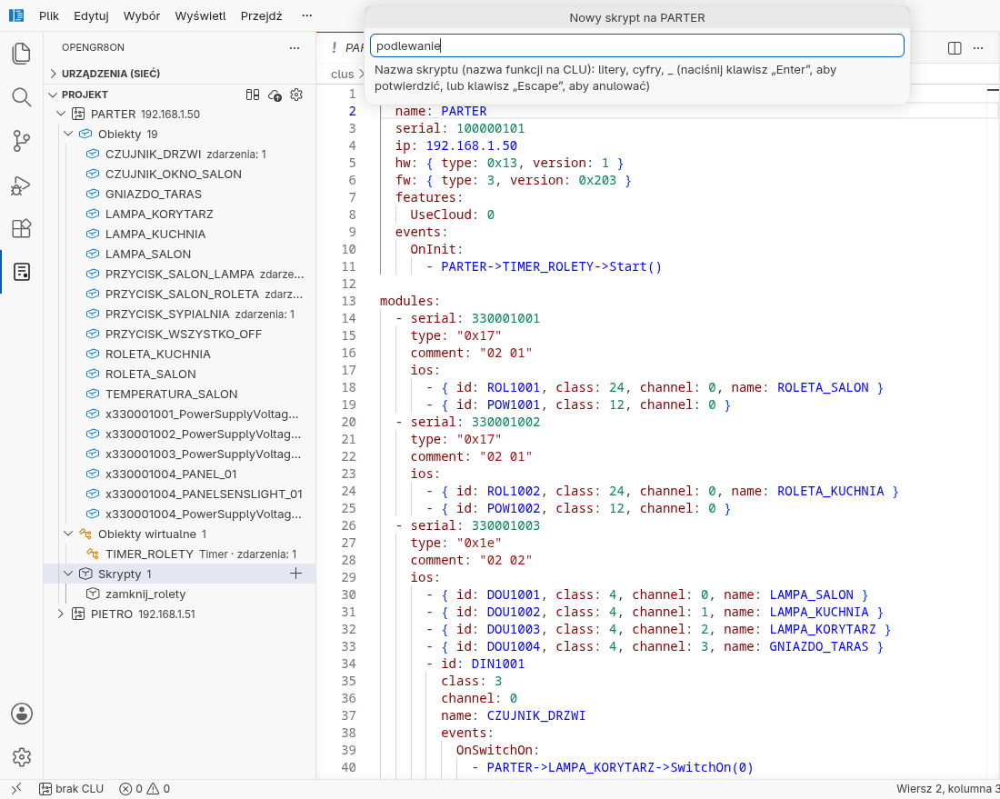

## 7. Błędy

Błędy w YAML i skryptach są podkreślane **już w trakcie pisania** (bez zapisywania) i widoczne
w panelu **Problemy** (Problems, Ctrl+Shift+M) z dokładnym miejscem. Sprawdzane jest m.in.:

- nieznany obiekt, cecha (`features`), zdarzenie, metoda, zła liczba argumentów,
- wartości cech wg definicji urządzenia: typ (liczba / tekst), zakres (np. `0..60000 ms`),
  dozwolone wartości (np. `Mode` przycisku: `0 (Normal)`, `1 (…)`), cechy tylko do odczytu.

Projekt z błędami nie zostanie wygenerowany ani wysłany; przed generowaniem niezapisane pliki
projektu trzeba zapisać (rozszerzenie o to zapyta).

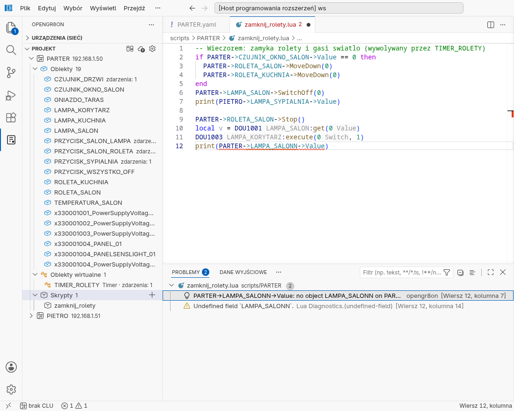

## 8. Generowanie, porównanie, wysyłanie

| Polecenie | Co robi |
|---|---|
| *OpenGr8on: Generuj OM.LUA* (ikona ⚙ w widoku projektu) | zapisuje `build/<CLU>/OM.LUA` i `USER.LUA` (końce linii jak w OM: ustawienie `opengr8on.generate.lineEndings` — `crlf` dla OM na Windows, `lf` dla OM na Linuksie) |
| *OpenGr8on: Porównaj wygenerowane z CLU* | pobiera pliki z CLU i pokazuje różnice |
| *OpenGr8on: Generuj i wyślij do CLU* (ikona ☁) | po potwierdzeniu wysyła oba pliki, sprawdza je po zapisie (odczyt i porównanie bajt po bajcie) i restartuje CLU |

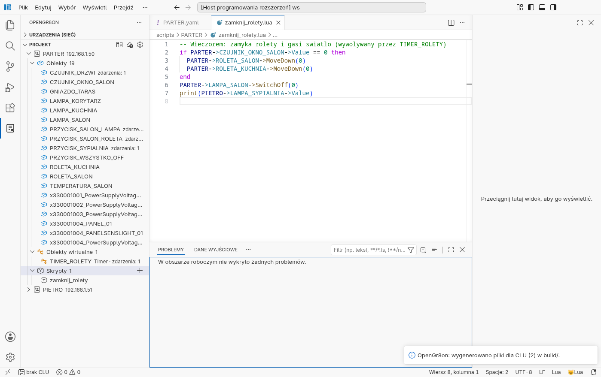

Wygenerowany plik zawiera wszystko, czego używa Object Manager — łącznie z komentarzami
(`-- NAME_IO`, `-- NAME_PERIPHERY`, …):

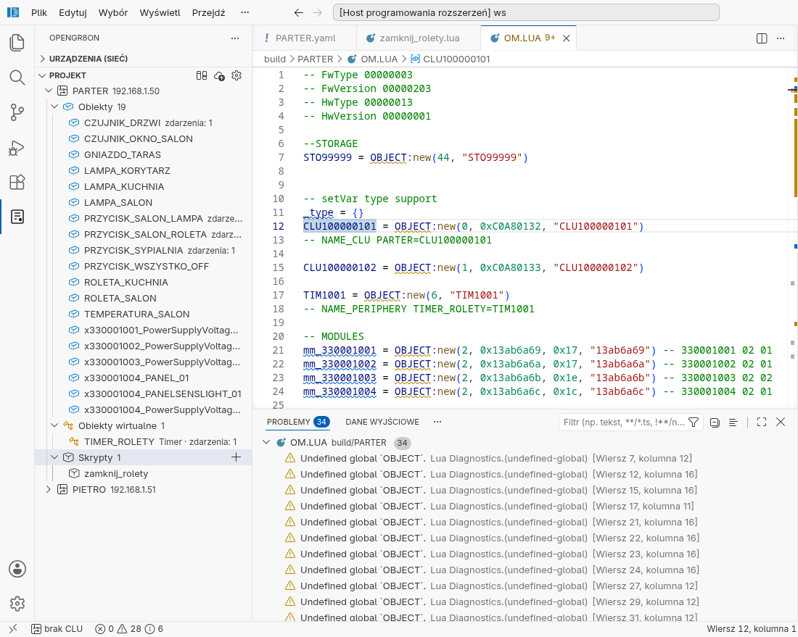

> Wysłanie zastępuje program CLU i restartuje je — wyjścia mogą się przełączyć w trakcie startu.
> Zacznij od jednego CLU i porównaj wcześniej (*Porównaj wygenerowane z CLU*).

## 9. Urządzenia w sieci

Widok **Urządzenia (sieć)** od razu pokazuje wszystkie CLU i bramki (GATE) z projektu — pod
nazwami z projektu, z adresem IP z `clus/<nazwa>.yaml`. **Wykrywanie nie jest potrzebne**: polecenia,
lista modułów i wartości na żywo łączą się z adresem z projektu (przydatne, gdy CLU są w innej
podsieci niż komputer — wykrywanie przez rozgłoszenie ich nie znajdzie). Dla CLU z projektu lista
pod *Moduły* pochodzi z projektu: najpierw **samo CLU** (jego cechy: Uptime, Date, Time, …), potem
moduły z obiektami i **obiekty wirtualne**; wartości są odczytywane na żywo z CLU.

Wartości na żywo CLU **wysyła samo przy każdej zmianie** (subskrypcja `SYSTEM:clientRegister`, port UDP
tego komputera) — bez ciągłego odpytywania. Jeśli te wiadomości nie docierają (np. zapora sieciowa
blokuje przychodzący UDP) albo CLU tego nie obsługuje, rozszerzenie samo przechodzi na odpytywanie co
2 s (ustawienia `opengr8on.liveValues.push` i `opengr8on.liveValues.intervalMs`). Pojedyncza zgubiona
odpowiedź nie jest zgłaszana jako błąd.

CLU znalezione przez wykrywanie są **zapamiętywane** (adres, MAC; nigdy klucze) i po ponownym
uruchomieniu VS Code nadal są na liście i działają pod zapamiętanym adresem. Urządzenia Z-Wave pod CLU
pokazują swoje obiekty i wartości tak jak moduły TF-Bus.

- **Wykryj CLU** — wykrywa CLU w sieci; **Wybierz interfejs sieciowy** — wybór karty sieciowej,
  gdy komputer ma ich kilka,
- na CLU (prawy przycisk): *Sprawdź, czy działa*, *Pobierz plik z CLU…*, *Pobierz pakiet diagnostyczny*,
  *Odśwież moduły*, *Ustaw adres IP…*, *Zrestartuj CLU…*, *Otwórz logi CLU*, *Ustaw poziom logów…*,
  *Importuj do projektu…*,
- **Dołącz CLU do projektu…** — nadaje CLU klucz projektu (potrzebny PIN z naklejki CLU). Uwaga:
  Object Manager straci wtedy dostęp do tego CLU, dopóki go ponownie nie dołączy,
- **Importuj klucze (keys.json)** — import kluczy z `.opengr8on/keys.json`,
- rozwinięcie CLU → *Moduły* → obiekt (albo *samo CLU*) pokazuje **wartości na żywo**; ikonami przy cechach
  i obiektach można zmieniać wartości i wywoływać metody.

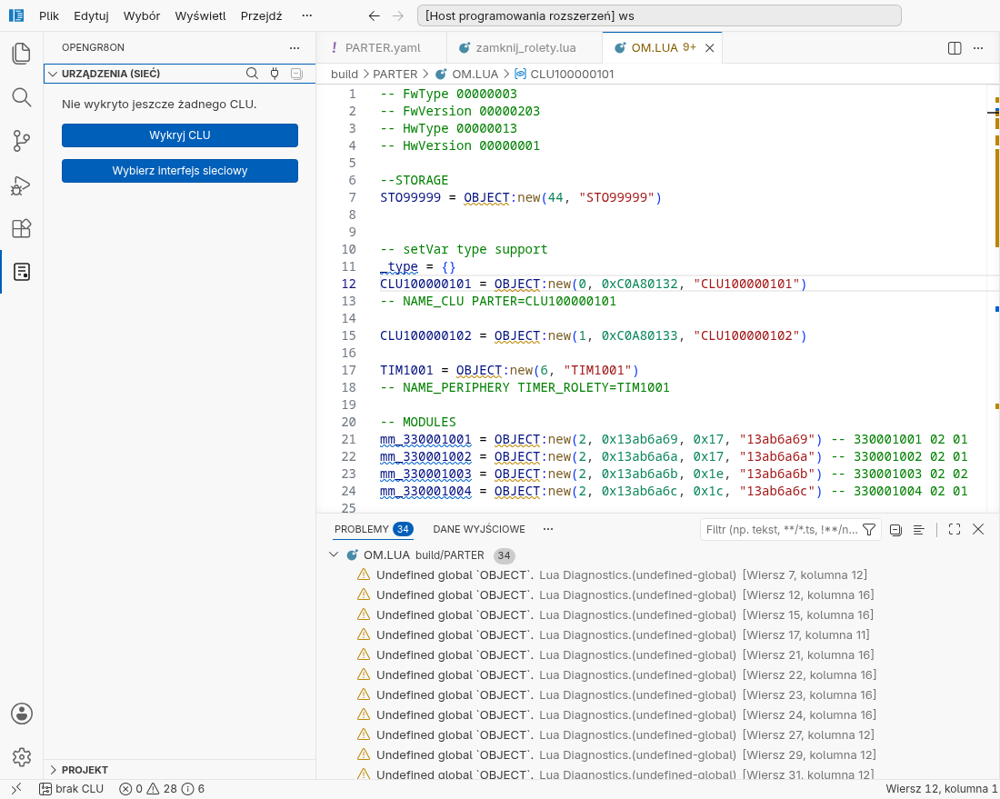

Wszystkie polecenia są dostępne w palecie (Ctrl+Shift+P, wpisz `OpenGr8on`):

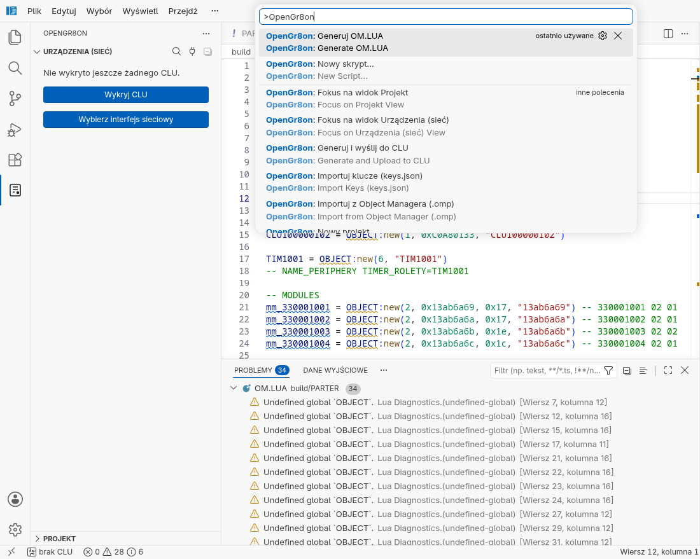

## 10. Ograniczenia

Rozszerzenie generuje tylko konstrukcje, których postać w plikach Object Managera jest potwierdzona.
Pozostałe są zgłaszane jako błąd zamiast zgadywania. Na razie:

- przypisanie cechy na **innym** CLU (`CLU_1->PRZYCISK->Mode = Bistable`) przyjmuje tylko stałą
  wartość (liczbę, tekst, nazwę) — jest wykonywane na tamtym CLU,
- odczyt cech-tabel obiektów HTTP (`ResponseBody`, `QueryStringParams`, nagłówki) z **innego** CLU —
  zgodnie z instrukcją GATE HTTP czyta się je skryptem na tej samej bramce.

Wartości tekstowe trafiają do pliku bez zmian, jako treść napisu Lua: cudzysłów zapisz jako `\"`,
podział wiersza jako `\n` (np. nagłówki HTTP: `'Month: April\r\n'`). Wywołanie skryptu musi kończyć
się w tej samej linii, a metoda z parametrami potrzebuje co najmniej pierwszego argumentu
(`Switch(0)`, nie `Switch()` — Object Manager zapisałby wtedy niedziałające `execute(0, )`).

Skrypty można wywoływać z dowolną liczbą argumentów, także na innym CLU — brakujące dostają `nil`,
więc działa wartość domyślna parametru.

Skrypty mogą mieć parametry z wartościami domyślnymi (i zakresem dla liczb), a CLU zmienne
użytkownika — w `clus/<CLU>.yaml`:

```yaml
variables:
  - { name: tryb_nocny, type: string, value: "nie", persist: true }
scripts:
  - name: podlewanie
    params:
      - { name: czas, type: number, default: 10, range: [1, 60] }
```

Szczegóły techniczne: [OM_LUA_FORMAT.md](OM_LUA_FORMAT.md), [PROJECT_FORMAT.md](PROJECT_FORMAT.md).
